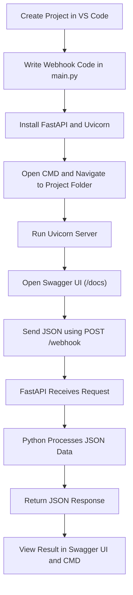

# Python Webhook Receiver using FastAPI

A beginner-friendly Python project that demonstrates how to create and run a webhook receiver using **FastAPI** and **Uvicorn**. The application receives HTTP POST requests containing JSON data, processes incoming events, and returns a JSON response.

##  Project Overview

A webhook is an event-driven mechanism through which one application automatically sends data to another application when a specific event occurs.

In this project, we simulate a payment notification using JSON data. The FastAPI application receives the event, checks whether the payment was successful, extracts payment details, and returns a response.

##  Technologies Used

- **Python** – Backend programming language
- **FastAPI** – Web framework for creating the webhook endpoint
- **Uvicorn** – ASGI server for running the application
- **Swagger UI** – Interactive API testing interface
- **JSON** – Data exchange format

##  Project Workflow

The following flowchart illustrates the complete execution process, from writing code to receiving and processing a webhook request.



## 📂 Project Structure

```text
WebHook_project/
│
└── main.py
```

##  Installation and Setup

### 1. Clone the Repository

```bash
git clone <your-repository-url>
```

### 2. Navigate to the Project Folder

```bash
cd WebHook_project
```

### 3. Install Required Dependencies

```bash
python -m pip install fastapi uvicorn
```

### 4. Run the Application

```bash
python -m uvicorn main:app --reload
```

The server will start at:

`http://127.0.0.1:8000`

##  Python Implementation

The following code creates a webhook endpoint that receives and processes payment events.

```python
from fastapi import FastAPI, Body

app = FastAPI()

@app.post("/webhook")
async def receive_webhook(data: dict = Body(...)):

    print("Webhook received!")
    print("Event:", data.get("event"))

    if data.get("event") == "payment.success":
        payment_id = data.get("payment_id")
        amount = data.get("amount")

        return {
            "status": "success",
            "payment_id": payment_id,
            "amount": amount
        }

    return {"status": "received"}
```

##  Testing the Webhook

### Step 1: Open Swagger UI

Visit:

`http://127.0.0.1:8000/docs`

### Step 2: Select the Endpoint

- Expand `POST /webhook`.
- Click **Try it out**.
- Enter the following JSON request body.

### Step 3: Send a Sample Payment Event

```json
{
    "event": "payment.success",
    "payment_id": "pay_12345",
    "amount": 500
}
```

Click **Execute** to send the request.

### Step 4: Expected Response

```json
{
    "status": "success",
    "payment_id": "pay_12345",
    "amount": 500
}
```

The terminal will also display:

```text
Webhook received!
Event: payment.success
```

##  How It Works

1. **FastAPI Initialization:** `app = FastAPI()` creates the application instance.
2. **Endpoint Creation:** `@app.post("/webhook")` defines the POST endpoint.
3. **Request Reception:** The endpoint receives JSON data through the request body.
4. **Event Processing:** Python checks the event type and extracts payment details.
5. **Response Generation:** FastAPI converts the returned dictionary into a JSON response.
6. **Output:** The response is displayed in Swagger UI, while print statements appear in the terminal.

##  Learning Outcomes

Through this project, I learned:

- Fundamentals of APIs and webhooks.
- Creating REST API endpoints using FastAPI.
- Understanding HTTP POST requests.
- Receiving and processing JSON data.
- Using asynchronous functions (`async def`).
- Running backend applications using Uvicorn.
- Testing APIs through Swagger UI.

##  Future Enhancements

- Integrate Razorpay payment gateway.
- Implement webhook signature verification.
- Store payment events in a database.
- Add error handling and duplicate event detection.
- Deploy the application with a publicly accessible HTTPS endpoint.

---

**Note:** This project currently uses a manually simulated payment event through Swagger UI. It is a learning implementation and is not yet connected to a live payment gateway.

**Built with Python and FastAPI ❤️**
